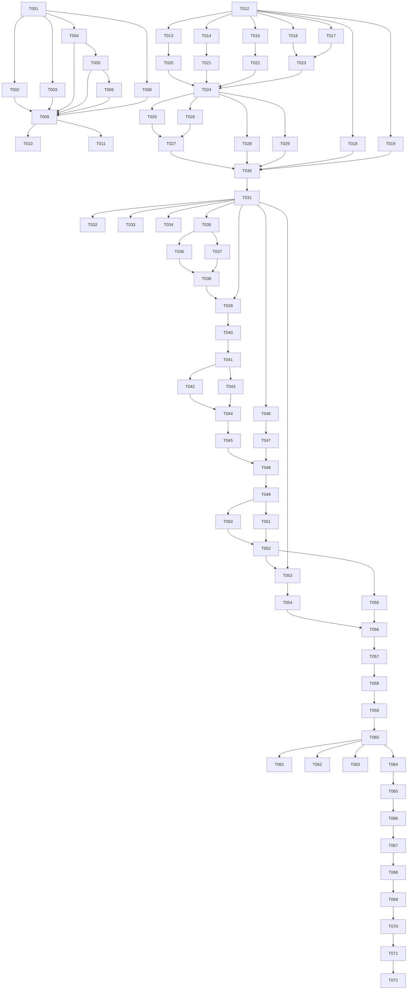

# Tasks: 轻鸿蒙浏览器（Lite Wearable 正文阅读浏览器）

**Input**: Design documents from `spec/lite-web-reader/`
**Prerequisites**: `plan.md`（已批准）、`spec.md`（已确认）

**Tests**: 本工程采用「Node 冒烟脚本」作为纯函数模块的测试手段（plan D11 已定义），不引入第三方测试框架。

**Organization**: 任务按用户故事分组，每个故事可独立实现与独立验收。

## Format: `[ID] [P?] [Story] Description`

- **[P]**: 可并行（不同文件、无未完成依赖）
- **[Story]**: 所属用户故事（US1~US5）
- 每个任务都带精确文件路径

## Path Conventions

- 工程根目录：`<repo>`
- 下文路径均相对该根目录
- Lite 页面根：`entry/src/main/js/MainAbility/pages/<name>/`
- 公共模块根：`entry/src/main/js/MainAbility/common/`

---

## Phase 1: Setup（工程骨架与工具链）

**Purpose**: 建立可构建的 FA 模型 Lite Wearable 工程骨架（`devecocli create` 不支持 liteWearable，必须手写）

- [X] T001 创建工程根配置文件 `build-profile.json5`（compile 26 / target `"7.0.0(26)"` / compatible `"5.0.0(12)"` / runtimeOS HarmonyOS / products[0].signingConfig = default）
- [X] T002 [P] 创建根 `hvigorfile.ts`（`legacyAppTasks`）、`oh-package.json5`、`hvigor/hvigor-config.json5`
- [X] T003 [P] 创建 `AppScope/app.json5`（bundleName = `com.example.litewearbrowser`，应用名"轻鸿蒙浏览器"）
- [X] T004 [P] 创建模块配置 `entry/build-profile.json5`（`apiType: "faMode"`、targets runtimeOS HarmonyOS）、`entry/hvigorfile.ts`（`legacyHapTasks`）、`entry/oh-package.json5`
- [X] T005 创建 `entry/src/main/config.json`：`deviceType: ["liteWearable"]`、ability `MainAbility`、`js` 节点登记 5 个页面路由
- [X] T006 [P] 创建资源 `entry/src/main/resources/base/element/string.json`、`color.json`，并从 DevEco `[Lite]Empty Ability` 模板复制图标到 `entry/src/main/resources/base/media/icon.png`
- [X] T007 [P] 创建 `entry/src/main/js/MainAbility/app.js`（onCreate/onDestroy，初始化偏好读取）
- [X] T008 运行 `devecocli signature generate --type debug` 自动生成签名材料并写入 `build-profile.json5`；若失败，退回手工登记 `~/.ohos/config/` 下材料并记录阻塞原因
- [X] T009 执行首次 `devecocli build --modules entry` 打通空骨架构建，确认产出 `entry-default-signed.hap`
- [X] T010 [P] 创建 Node 冒烟脚本骨架 `tools/smoke.js`（可 `require` 公共模块、打印通过/失败计数、失败退出码非 0）
- [X] T011 [P] 创建帧抓取脚本 `tools/capture-frame.js`（连接 Simulator `-lws` 端口，切掉 40 字节头后写 JPEG）

---

## Phase 2: Foundational（阻塞性前置，所有故事依赖）

**Purpose**: 纯函数算法层、网络层、存储层与会话层全部就绪；这些完成前任何用户故事都无法验收

**⚠️ CRITICAL**: 本阶段完成前不得开始任何用户故事

- [X] T012 [P] 实现 `entry/src/main/js/MainAbility/common/config.js`：屏幕基准 408×480、安全边距、页头 44、页脚 46、字号/行距档位、全部上限（128KB / 5 万字 / 40 链接 / 50 条存储）、存储键、提示文案
- [X] T013 [P] 实现 `entry/src/main/js/MainAbility/common/url.js`：`normalize` / `resolve` / `hostOf` / `displayOf`，全部用 `indexOf`/`charAt` 手写，**禁止正则字面量**
- [X] T014 [P] 实现 `entry/src/main/js/MainAbility/common/html.js`：单遍扫描抽取 title / 正文 / 链接；跳过 script/style；HTML 实体解码；畸形标签容错；超过 128KB 截断并置 `truncated`
- [X] T015 [P] 实现 `entry/src/main/js/MainAbility/common/paginate.js`：按字号估算字宽折行，输出 `{starts[], pageCount}`（**数字数组，不是字符串数组**），并提供单页切片函数
- [X] T016 [P] 实现 `entry/src/main/js/MainAbility/common/store.js`：书签/历史/偏好三键读写、去重、上限 50 条裁剪、标题 40 字截断、异常返回安全默认值
- [X] T017 [P] 实现 `entry/src/main/js/MainAbility/common/sample.js`：约 1.2 千字离线示例 + 3~5 条示例链接，返回 Document 形态对象
- [X] T018 实现 `entry/src/main/js/MainAbility/common/net.js`：`@system.fetch` 封装、自增序号令牌、12s 超时守卫、失败分类（offline/timeout/unreachable/unsupported）、`canIUse` 能力探测
- [X] T019 实现 `entry/src/main/js/MainAbility/common/session.js`：当前文档/页码/导航栈；**保证同时持有 doc 的帧 ≤ 2**，更早帧释放 doc 仅留 url+title+pageIndex
- [X] T020 在 `tools/smoke.js` 中补齐 `url` 用例（协议补全、非法地址、相对地址解析、host 提取）
- [X] T021 在 `tools/smoke.js` 中补齐 `html` 用例（标题/正文/链接抽取、脚本样式剔除、实体解码、畸形标签、超长截断）
- [X] T022 在 `tools/smoke.js` 中补齐 `paginate` 用例（空文本 1 页、中英混排不溢出、**返回数字数组**、页数稳定可复现）
- [X] T023 在 `tools/smoke.js` 中补齐 `store` 与 `sample` 用例（上限裁剪、去重、默认值、示例可分页）
- [X] T024 运行 `node tools/smoke.js` 全绿，并把结果记录到构建日志

**Checkpoint**: 算法层可独立验证，页面可以开始接入

---

## Phase 3: User Story 1 - 输入网址并阅读正文（Priority: P1）🎯 MVP

**Goal**: 首页输入地址 → 抓取 → 抽取 → 分页 → 逐页阅读的最小闭环

**Independent Test**: 启动应用 → 首页输入一个可访问地址 → 看到标题与正文第 1 页 → 连续翻页到文末 → 返回首页；全程不依赖书签/历史/设置

### Implementation for User Story 1

- [X] T025 [P] [US1] 创建首页结构 `entry/src/main/js/MainAbility/pages/index/index.hml`（地址栏 `input type="text"` + `input type="button"` 确认；四个显式高度区块：最近阅读/书签/历史/离线示例）
- [X] T026 [P] [US1] 创建首页样式 `entry/src/main/js/MainAbility/pages/index/index.css`（408×480、左右 12px、顶部 8px 安全边距、圆角区不放可点元素）
- [X] T027 [US1] 实现首页逻辑 `entry/src/main/js/MainAbility/pages/index/index.js`：地址输入绑定、`url.normalize` 校验、非法输入就地提示、合法则 `router.push` 到阅读页
- [X] T028 [P] [US1] 创建阅读页结构 `entry/src/main/js/MainAbility/pages/reader/reader.hml`（页头 44 + 正文区 386 + 页脚 46；上下各 1/3 宽透明翻页热区）
- [X] T029 [P] [US1] 创建阅读页样式 `entry/src/main/js/MainAbility/pages/reader/reader.css`（正文宽 384、固定行高、单行折行、浅色主题基线）
- [X] T030 [US1] 实现阅读页加载链路 `entry/src/main/js/MainAbility/pages/reader/reader.js`：会话 → 路由参数 → 离线示例的取值顺序；调用 `net.fetchText` + `html.parse` + `paginate`；加载态展示
- [X] T031 [US1] 实现阅读页渲染与翻页 `entry/src/main/js/MainAbility/pages/reader/reader.js`：只渲染当前页切片、页码 `n/N`、首页/末页边界钳制、点击热区翻页
- [X] T032 [US1] 实现阅读页 `swipe` 兜底翻页（事件对象做存在性判断，取不到方向时静默忽略），位置在 `entry/src/main/js/MainAbility/pages/reader/reader.js`
- [X] T033 [US1] 在阅读页接入最小失败态与空正文态（占位文案 + 返回入口），位置在 `entry/src/main/js/MainAbility/pages/reader/reader.js`
- [X] T034 [US1] 实现返回逻辑：阅读页返回首页；`session.pop` 恢复上一帧页码；首页返回退出应用，位置在 `entry/src/main/js/MainAbility/pages/reader/reader.js` 与 `entry/src/main/js/MainAbility/pages/index/index.js`
- [X] T035 [US1] 构建并检查单页 bundle 体积（每个 `pages/*/*.js` ≤ 48KB，目标 ≤ 40KB），记录到构建日志

**Checkpoint**: US1 可独立演示；此时应用已是一个可用阅读器

---

## Phase 4: User Story 2 - 跟随正文链接继续浏览（Priority: P2）

**Goal**: 链接清单 → 打开目标页 → 返回恢复原文章原页码

**Independent Test**: 打开含链接页面 → 打开链接面板 → 选择一条 → 看到新页面 → 返回 → 回到原文原页码；无链接时显示空态

### Implementation for User Story 2

- [X] T036 [P] [US2] 创建链接页结构 `entry/src/main/js/MainAbility/pages/links/links.hml`（`list` + `list-item`，`for` 渲染必须带唯一 `tid`）
- [X] T037 [P] [US2] 创建链接页样式 `entry/src/main/js/MainAbility/pages/links/links.css`（行高 ≥ 44、单行省略、显式宽高）
- [X] T038 [US2] 实现链接页逻辑 `entry/src/main/js/MainAbility/pages/links/links.js`：读取会话当前文档链接、渲染锚文本/可读地址、点击后 push 并跳转阅读页
- [X] T039 [US2] 实现阅读页链接入口与跳转 `entry/src/main/js/MainAbility/pages/reader/reader.js`：页脚入口、`session.push` 当前帧、跳转 `pages/links/links`
- [X] T040 [US2] 实现链接目标打开与栈行为 `entry/src/main/js/MainAbility/pages/reader/reader.js`：目标页压栈、返回时恢复原文原页码（doc 被释放时触发重抓 + 页码定位）
- [X] T041 [US2] 实现无链接空态与链接数量标注，位置在 `entry/src/main/js/MainAbility/pages/links/links.js` 与 `entry/src/main/js/MainAbility/pages/links/links.hml`

**Checkpoint**: US1 + US2 均可独立验收

---

## Phase 5: User Story 3 - 保存书签与回访历史（Priority: P3）

**Goal**: 收藏/取消收藏、历史倒序、单条删除与清空、重启保持

**Independent Test**: 阅读文章 → 收藏 → 返回首页 → 书签列表打开它；历史列表出现本次访问；重启后内容仍在

### Implementation for User Story 3

- [X] T042 [P] [US3] 创建书架页结构 `entry/src/main/js/MainAbility/pages/shelf/shelf.hml`（书签/历史两个 tab 或分段切换；列表用 `list` + `list-item`）
- [X] T043 [P] [US3] 创建书架页样式 `entry/src/main/js/MainAbility/pages/shelf/shelf.css`（每行 ≥ 48 高、标题单行省略、删除按钮命中区 ≥ 40×40）
- [X] T044 [US3] 实现书架页书签分页 `entry/src/main/js/MainAbility/pages/shelf/shelf.js`：读取、展示、点击打开、单条删除
- [X] T045 [US3] 实现书架页历史分页 `entry/src/main/js/MainAbility/pages/shelf/shelf.js`：时间倒序、点击打开、单条删除、清空全部（二次确认）
- [X] T046 [US3] 实现阅读页收藏开关 `entry/src/main/js/MainAbility/pages/reader/reader.js`：已收藏态回显、添加/取消、写失败提示但不打断阅读
- [X] T047 [US3] 在阅读页成功加载文档后写入历史（标题+地址+时间，去重前移），位置在 `entry/src/main/js/MainAbility/pages/reader/reader.js`
- [X] T048 [US3] 首页接入书签/历史摘要与"最近阅读"直达卡片，位置在 `entry/src/main/js/MainAbility/pages/index/index.js` 与 `entry/src/main/js/MainAbility/pages/index/index.hml`
- [X] T049 [US3] 验证持久化：冷启动后书签/历史保持，`tools/smoke.js` 增加 50 条上限与去重用例

**Checkpoint**: US1~US3 均可独立验收

---

## Phase 6: User Story 4 - 调整阅读观感（Priority: P4）

**Goal**: 字号/行距/深浅主题即时生效，重排不丢阅读位置，重启保持

**Independent Test**: 阅读页调大字号 → 正文重排且停留在原内容附近 → 切深色主题 → 重启后设置仍在

### Implementation for User Story 4

- [X] T050 [P] [US4] 创建设置页结构 `entry/src/main/js/MainAbility/pages/settings/settings.hml`（字号档位、行距档位、主题切换，使用白名单内 `slider`/`switch`/`input type="radio"`/`div`）
- [X] T051 [P] [US4] 创建设置页样式 `entry/src/main/js/MainAbility/pages/settings/settings.css`（两套主题类、可点区域 ≥ 40×40）
- [X] T052 [US4] 实现设置页逻辑 `entry/src/main/js/MainAbility/pages/settings/settings.js`：读写偏好、即时生效、返回阅读页
- [X] T053 [US4] 实现阅读页重分页与位置映射 `entry/src/main/js/MainAbility/pages/reader/reader.js`：按"当前页首字符偏移 ÷ 正文总长"映射到新页，禁止跳回第 1 页
- [X] T054 [US4] 实现阅读页双主题渲染（浅色/深色），位置在 `entry/src/main/js/MainAbility/pages/reader/reader.css` 与 `entry/src/main/js/MainAbility/pages/reader/reader.js`
- [X] T055 [US4] 设置持久化与异常降级，位置在 `entry/src/main/js/MainAbility/common/store.js` 与 `entry/src/main/js/MainAbility/pages/settings/settings.js`

**Checkpoint**: US1~US4 均可独立验收

---

## Phase 7: User Story 5 - 无网也能演示与优雅失败（Priority: P5）

**Goal**: 四类失败可区分 + 离线示例完整可读

**Independent Test**: 断网后请求任意地址 → 看到"网络不可用"+重试；进入离线示例 → 完整阅读并翻页，全程无网络请求

### Implementation for User Story 5

- [X] T056 [US5] 实现首页离线示例入口（无需网络即可进入阅读页），位置在 `entry/src/main/js/MainAbility/pages/index/index.js` 与 `entry/src/main/js/MainAbility/pages/index/index.hml`
- [X] T057 [US5] 实现阅读页四类失败态与可区分文案（无网络/超时/不可达/无正文），位置在 `entry/src/main/js/MainAbility/pages/reader/reader.js` 与 `entry/src/main/js/MainAbility/pages/reader/reader.hml`
- [X] T058 [US5] 接入 `@system.network.getType` 与 `canIUse` 预判，请求前短路并给出对应失败态，位置在 `entry/src/main/js/MainAbility/common/net.js`
- [X] T059 [US5] 实现失败态的"重试"与"返回首页"动作，重试复用同一地址与序号令牌，位置在 `entry/src/main/js/MainAbility/pages/reader/reader.js`
- [X] T060 [US5] 处理非 HTML/空正文/纯图片页：纯文本按正文展示，其它给"暂不支持该类型内容"，位置在 `entry/src/main/js/MainAbility/common/html.js` 与 `entry/src/main/js/MainAbility/pages/reader/reader.js`

**Checkpoint**: 全部 5 个用户故事可独立验收

---

## Phase 8: Polish（跨故事收尾）

**Purpose**: 体积、内存、白名单、可安装性四项硬约束的最终稽核

- [X] T061 [P] 稽核 HML 标签与事件全部落在 Lite 白名单内（对照 `lite_component_map.js` 的 22 个标签），位置：`entry/src/main/js/MainAbility/pages/*/*.hml`
- [X] T062 [P] 稽核公共模块无正则字面量、无 Promise/async/箭头函数之外的 ES6+ 语法，位置：`entry/src/main/js/MainAbility/common/*.js`
- [X] T063 [P] 稽核内存预算：原文 128KB 截断、正文 5 万字截断、链接 40 条、会话栈 doc ≤ 2、列表渲染 ≤ 50，位置：`entry/src/main/js/MainAbility/common/config.js` 及各调用点
- [X] T064 稽核嵌套容器均显式设置宽高（防 Lite 高度塌陷），页面方法未占用 `render` 保留名，位置：`entry/src/main/js/MainAbility/pages/*/*.hml` 与 `*.js`
- [X] T065 清理调试日志与无用代码，保留关键错误日志（hilog 风格 console）
- [X] T066 编写真机安装说明（签名 HAP 拷贝到手机 → 运动健康配对 → 应用调测助手安装），位置 `docs/install.md`

---

## Phase 9: Verification

<!-- verification_scope: build+ui -->

**Purpose**: 构建、签名、部署与界面取证

- [X] T067 执行 `devecocli build --modules entry` 并修复所有编译错误，直到退出码 0
- [X] T068 确认签名产物存在且为最新：`entry/build/default/outputs/default/entry-default-signed.hap`
- [X] T069 部署：优先 `devecocli run --skip-build`；若 CLI 不识别 Lite Wearable，则按 plan D11 启动 headless `Simulator.exe`（`-or 408 480 -cr 408 480 -shape rect -lws <port>`）加载 `entry/build/default/intermediates/lite_source/default/assets/js/MainAbility`
- [X] T070 逐页抓帧：对 `pages/index/index`、`pages/reader/reader`、`pages/links/links`、`pages/shelf/shelf`、`pages/settings/settings` 各抓至少 1 帧并存为 JPEG
- [X] T071 UI 验证：按用户故事逐条核对帧内容与日志（无 `[JS Error]`、`[ACELite][ERROR]`、`Expected a function`、`wrong type of argument`），记录通过/失败
- [X] T072 产出验证报告：构建结果、bundle 体积、抓帧证据、逐故事结论、真机待验清单

---

## Phase 10: 1.3.0 增量（性能与正文质量）

**Purpose**: 落地 `docs/HANDOVER.md` 第六节的前三项待办，并把打包流程脚本化

- [X] T073 [P] `common/net.js` 常驻 gzip：请求头加 `Accept-Encoding: gzip, deflate`（`Config.ACCEPT_ENCODING`），并在注释中记录与 `Range` 分片的冲突处理
- [X] T074 [P] 新增纯函数模块 `common/paging.js`（`sizeOf` / `countOf` / `windowOf` / `slice`），页码越界一律钳制
- [X] T075 `pages/shelf/shelf.js` + `shelf.hml` + `shelf.css` 接入分页：每页 `LIST_PAGE_SIZE` 条、底部 `‹ 1/5 ›` 分页器、删除/清空/切 tab 后页码钳制
- [X] T076 `pages/links/links.js` + `links.hml` + `links.css` 接入分页：同上，列表高度与分页器共占安全区
- [X] T077 `common/html.js` 翻页控件识别支持 `title` / `aria-label` 兜底（锚文本只有一个 `›` 时仍能识别）
- [X] T078 `common/html.js` 新增 `stripNoise` + `Config.NOISE_WORDS` / `NOISE_MAX_CHARS`：只删短噪声行，长段落不误伤
- [X] T079 修复 `tools/smoke.js`：移除已删除的 `sample` 用例与 3 条过期断言，新增 paging 7 条与 html 4 条用例，`node tools/smoke.js` 42 条全绿
- [X] T080 新增 `tools/pack-app.ps1`（字段补丁 + `.app` 组装 + 固定时间戳可复现）与 `tools/build.ps1`（冒烟 → 构建 → 打包一条命令）
- [X] T081 版本号 1.0.1(1001) → 1.3.0(1004)；构建 release hap 并核对各页 bundle 体积（最大 reader 42.9 KB）
- [X] T084 `pages/shelf/shelf.css` 修正列表高度：360px → 280px（56px × 5 行），原高度让底部 72px 落到安全区外被圆角裁切；`empty` 态同步
- [ ] T082 真机复验：环境诊断页确认 `@system.fetch` 放行 + gzip 自动解压 + `Range` 与压缩共存时正文正常（本轮唯一未真机验证项）
- [ ] T083 真机复验：shelf / links 造 20+ 条数据，确认分页器命中区与列表滚动不冲突

---

## Phase 11: 1.3.1 增量（手势、返回与表冠）

**Purpose**: 修复诊断页无法返回，统一「右滑返回」，取消左右翻页，并把表冠接入翻页通道

- [X] T085 新增 `common/gesture.js`：`swipeDir` / `keyStep` / `isBack` / `keyCodeOf` / `describe` / `pointOf` / `swipeFromDelta` / `remember` / `take`；keyCode 兼容 OpenHarmony（DPAD 2012~2015、PAGE 2068/2069、ESCAPE 2070）与 Android 风格（19~22、BACK 4）
- [X] T086 `pages/diag` 修复无法返回：页头 `‹` 按钮 + 底部「返回首页」按钮 + 右滑/返回键，全部 `Route.goHome()`
- [X] T087 全局滑动返回：`links` / `shelf` / `settings` / `diag` 根节点绑定 `onswipe` + `ontouchstart/ontouchend`，右滑返回；`reader` 右滑走 `leave()`
- [X] T088 `pages/reader` 取消左右翻页：删除 `zone-left` / `zone-right` 与对应 CSS，改为 `zone-top` / `zone-bottom` 上下点击兜底区
- [X] T089 `pages/reader` 只保留上下滑动翻页（上滑下一页、下滑上一页），左滑不触发翻页
- [X] T090 表冠接入：`onKey` 把方向键/PAGE 键映射为上下翻页，ESCAPE/BACK 映射为返回；`swipe` 与触摸轨迹双通道在 `applySwipe` 内 300ms 去重
- [X] T091 诊断页新增「表冠 / 手势自检」行，显示最近一次 swipe/touch/key 原始事件，用于真机确认表冠通道
- [X] T092 `tools/smoke.js` 新增 gesture 4 条用例（方向归一化、表冠键值、返回键、describe 截断），共 **46 条全绿**；`tools/build.ps1` 全流程通过，审计脚本无 ERROR
- [ ] T093 真机复验：诊断页转表冠，确认自检行是否出现 `key ...`；若始终只有 `swipe`/`touch`，说明表冠不派发 key，需改 `swiper vertical` + 3 槽位虚拟页方案
- [ ] T094 真机复验：阅读页右滑返回、上下滑动翻页、点击上下半屏翻页三条路径互不干扰

> **T093 真机结论（2026-11-04）**：表冠检测失败，key 事件不派发。T093 关闭，表冠控制设计取消（见 Phase 12）。
> **T094 真机结论（2026-11-04）**：手势测试完全通过。

---

## Phase 12: 1.4.0 增量（搜索 + 表冠取消）

**Purpose**: 取消表冠设计（真机否决 key 通道）；接入轻量搜索引擎实现手表端网页搜索

- [X] T095 取消表冠控制设计：各页删除 `onkey` 绑定与 `onKey` 方法；`common/gesture.js` 删除 key 通道（`keyStep`/`keyCodeOf`/`isBack`/`NAME_TO_CODE`）；诊断页自检只保留 swipe/touch 观察
- [X] T096 引擎选型实测（本机抓包，同一关键词对比 5 个国内引擎）：必应中国 RSS 6~7KB / 10 条直链结果，比搜狗 240KB 省 97%、比百度 1.9MB 省 99.6%；采用 `cn.bing.com/search?format=rss&q=`
- [X] T097 重写 `common/search.js` 为 RSS 解析器：`buildUrl` / `parse`（`<item>` 块提取 title/link/description）、实体解码、百分号编码兜底、非 XML 归类为 error；无正则字面量
- [X] T098 新页面 `pages/search/search`：自绘搜索框（`input type=text`）+ 自绘搜索按钮（div）、结果列表（标题/摘要/站点 72px 条目）、点击结果进 reader 打开直链、失败态重试、空态提示
- [X] T099 首页接入：地址栏搜索兜底（无点/冒号/斜杠或含空格 → 搜索页）；「最近阅读」区块改为「搜索」入口
- [X] T100 `tools/smoke.js`：删 key 用例，新增 search 5 条 + gesture pointOf 1 条，共 **51 条全绿**
- [X] T101 修复 jerry-snapshot 64KB 工具堆溢出：`describe` 移入 diag.js、精简 `pointOf`，reader.js 45,276→44,682B，`reader.bc`（37.5KB）恢复生成
- [X] T102 版本号 1.3.1(1005) → 1.4.0(1006)；构建打包，审计无 ERROR
- [ ] T103 真机复验搜索链路：关键词搜索 → 10 条结果渲染 → 点击进 reader 打开直链；确认 cn.bing.com 请求放行
- [ ] T104 真机复验手势回归（1.3.1 通过项在 1.4.0 瘦身改动后复测）

---

## Phase 13: 1.5.0 增量（搜索新体验 + 换装）

**Purpose**: 应用换图标更名；搜索结果 20 条、双行控件、网页摘要页、返回保留结果

- [X] T105 应用图标更换：用户提供的 92×92 蓝底书本图替换三处 media（icon_small / icon / app_icon），构建产物核对通过
- [X] T106 应用更名「轻鸿浏览器」：两份 string.json、index.hml、reader.js 默认标题、install.md 全部替换
- [X] T107 搜索结果 10→20 条：实测 `count=20` 无效、`first=11` 取第二页有效；`buildUrl(query, page2)` + `mergeResults` 按 url 去重合并
- [X] T108 结果控件改版：只显示主标题 + 副标题（50px/条，不显示网址）；副标题 = 摘要截断 28 字
- [X] T109 新页面 `pages/detail/detail` 网页摘要：主副标题 + 完整摘要（260 字，overflow:scroll + 动态行高）+ 网址；「访问」→ reader、「返回」→ 搜索页（restore 标记）
- [X] T110 新增 `common/searchcache.js`：globalThis + storage 双通道结果缓存，返回搜索页时恢复结果不重新搜索；缓存空给失效空态
- [X] T111 搜索结果分页（paging.js 10 条/页 × 2 页），点击条目传全量索引（pageStart + index）
- [X] T112 `tools/smoke.js` 新增/改写 search 5 条 + searchcache 2 条，共 **53 条全绿**；审计无 ERROR；8 页快照全部生成
- [X] T113 版本号 1.4.0(1006) → 1.5.0(1007)；构建打包
- [ ] T114 真机复验搜索全链路：20 条翻页 → 摘要页 → 访问 → 返回保留结果
- [ ] T115 真机复验摘要页 overflow:scroll 触摸滚动（不可滚则长摘要裁切降级）

> **1.5.0 真机故障（2026-11-04）**：搜索永久卡「正在搜索」。根因是 T107 的双请求并发撞上 `common/net.js` 序号令牌（单请求语义，后发请求会吞掉先发请求的回调）。T107 的 20 条方案已回退为 10 条单请求（见 T116），T114 以 10 条为准复验。

---

## Phase 14: 1.5.1 修复（搜索卡加载）

- [X] T116 回退搜索为 10 条单请求：`SEARCH_MAX_RESULTS` 20→10、`buildUrl` 去分页参数、删 `mergeResults`、`doSearch` 单请求单回调（失败/空态都有出口，不再无限加载）；`restoreFromCache` 加防重入；**约束固化：禁止并发 `fetchText`**（Config 注释 + HANDOVER 运行时约束表）
- [X] T117 冒烟 52 条全绿、审计无 ERROR、8 页快照齐全；版本 1.5.1(1008) 构建打包
- [ ] T118 真机复验：搜索出结果（10 条双行控件）→ 摘要页 → 访问 → 返回保留结果；失败场景给失败态而非卡死

> **1.5.1 真机故障（2026-11-04）**：点击条目显示「结果已失效」。根因：SearchCache 把 ~4KB JSON 存 `@system.storage`，而 **storage 单 value 硬限制 128 字节**，写入静默失败；globalThis 通道在 Lite 不可靠。1.6.0 改为同页双视图方案（见 Phase 15）。

---

## Phase 15: 1.6.0（结果保留修复 + 黑底蓝字改版）

- [X] T119 「结果已失效」修复：摘要页改为 search 页内第二视图（同页 if/elif 切换），数据留页面内存——返回列表零请求、结果与页码原样保留；删除 `searchcache.js` 与 `pages/detail/`（8→7 页）
- [X] T120 黑底蓝字全局改版（Apple Watch / 华为风格）：纯黑 #000000 + 蓝字 #64B5FF + 苹果蓝 #0A84FF + 深灰卡 #1C1C1E；`DEFAULT_THEME: 'dark'`；index/shelf/links 静态 CSS 黑化
- [X] T121 search 页大字重构：搜索框/按钮 48px 高、条目 60px（19px 蓝主标题 + 13px 灰副标题）、每页条目 10→4（`SEARCH_PAGE_SIZE`）、分页按钮 48×40
- [X] T122 摘要视图：主标题 20px 白 2 行 + 副标题 14px 蓝 + 完整摘要 16/24 可滚动 + 网址 13px 灰 + 访问/返回 52px 胶囊按钮
- [X] T123 冒烟 51 条全绿（searchcache 用例改为删除断言）、7 页快照齐全、版本 1.6.0(1009) 构建打包
- [ ] T124 真机复验：搜索 → 摘要视图 → 返回列表结果/页码原样保留 → 访问进 reader
- [ ] T125 真机复验：黑蓝 UI 可读性与命中区、摘要区滚动、右滑返回双语义

---

## Phase 16: 1.7.0（主题统一 + 华为风大控件 + 去主题切换）

- [X] T126 主题统一为唯一色板 `Config.COLORS`（黑底蓝字），删除 `THEMES` 双主题与 `DEFAULT_THEME`
- [X] T127 去除主题切换：settings 删「深色主题」开关，store prefs 去 `theme` 字段（历史数据忽略），reader 固定 `Config.COLORS`
- [X] T128 控件全面增大（华为手表系统应用风格）：hdr/按钮 52px、列表项 72px、输入框 52px、分页键 56×48、圆角 16px、按钮字 19~21px
- [X] T129 字号档 [16,18,20,22]→[18,20,22,24]（默认 20）；`LIST_PAGE_SIZE` 10→3 统一三页（search/shelf/links 同一常量）
- [X] T130 首页改 5 项大菜单列表（搜索网页/书签/历史/测试站/环境诊断，72px/项）；阅读页 hdr/ftr 52px 正文区 292px
- [X] T131 冒烟 51 条全绿（分页用例显式页宽 + 默认 3 条/页断言）、7 页快照齐全、版本 1.7.0(1010) 构建打包
- [ ] T132 真机复验：统一黑蓝主题下各页可读性、72px 条目与 52px 按钮手感、首页菜单滚动、设置页字号/行距生效

---

## Phase 17: 1.8.0（去诊断 + 过渡动画 + 美化）

- [X] T133 环境诊断功能移除：删 `pages/diag/`、config.json 注册、首页菜单项（菜单 5→4）；诊断验证结论保留在 HANDOVER
- [X] T134 新增 `common/fade.js`：Lite 无 CSS transition（SDK styleMap 已核对），3 步 opacity 淡入（0.25/0.6/1.0，45ms/帧，<100ms），页面 `onDestroy` 统一 `Fade.cancel`
- [X] T135 全页接入过渡动画：首页菜单进入、搜索加载/失败/空态、列表↔摘要切换、阅读页翻页、shelf/links 加载翻页、settings 进入
- [X] T136 界面美化：列表条目统一左侧 6px 苹果蓝强调色条 + 右侧 › 箭头；搜索状态行改胶囊徽章；四类列表卡片样式统一
- [X] T137 冒烟 53 条全绿（新增 fade 2 条）、6 页快照齐全、审计无 ERROR、版本 1.8.0(1011) 构建打包
- [ ] T138 真机复验：淡入过渡流畅度（翻页/视图切换/加载）、色条箭头美化效果、diag 入口已消失

> **风险提示（1.9.0 修正）**：jerry-snapshot 阈值与字符串池构成相关而非纯字节数——TXT 文案表拆出后 reader.js 47,334B 快照仍成功。改 reader.js 后确认 `reader.bc` 重新生成即可，文案常量优先拆独立小模块。

---

## Phase 18: 1.9.0（本地缓存 + 分批读取）

- [X] T139 新增 `common/cache.js`：`@system.file` 缓存层——writeText append 分批写（3000 字/批）、readText 分片读（2500 字/片）、`loadRange` 按字符区间读页、**position 语义探测**（probe 自校验字节/字符偏移并存 storage）、LRU 6 组容量管理、全链路降级
- [X] T140 reader 接入：HTML 缓存（抓取后台写、二次打开免流量、重试强制刷新）+ 正文缓存（翻页按页从缓存文件提取，失败降级内存切片）
- [X] T141 config.js 拆分减重：SEARCH_* → `searchcfg.js`、TXT/TEST_* → `txt.js`（reader 自留 5 条短文案）；jerry-snapshot 红线认识修正（字符串池构成相关）
- [X] T142 冒烟 59 条全绿（cache 6 条：keyOf/分批写/字符语义/字节语义/分片读/容量淘汰）、6 页快照齐全（reader.bc 40.5KB 手动复验）、审计无 ERROR、版本 1.9.0(1012) 构建打包
- [ ] T143 真机复验缓存链路（最重要）：同一篇二次打开免流量秒开、翻页正常、重试强制刷新；确认 `@system.file` 真机可用性并把结论记回 HANDOVER

---

## Phase 19: 1.9.1（真机三连修：假超时 / 缓存加固 / 小说站阅读流）

- [X] T144 假超时根因修复：cache.js 全部 `file.*` 调用 try/catch + `once()` 一次性回调 + 600ms 兜底计时——file 异常不再炸掉 fetch 的 `onBody`（「服务器响应超时」假象根因）；smoke 新增异常兜底用例
- [X] T145 缓存语义补课：save 成功后语义未定时自动 `probe`（save 拥有原文是唯一可靠探测时机）；显式 probe 总是重测；HTML 缓存读取不再依赖猜测语义
- [X] T146 超时 8s→20s（表端 TLS + 45.5KB/s 对大页面太紧）；超限响应「判失败」改「截断放行」（解析器容忍残缺页，至少看到目录/前几段）
- [X] T147 小说站阅读流：新增 `common/navrule.js`（「开始阅读」类 + 「第x章」类识别）；html.js 提取 `startHref`/`chapters`；reader 书名/目录页「开始阅读 ›」「目录」直达控件；「上一章/下一章」原有词表续读；links 页章节置顶
- [X] T148 快照抢救（部分失败）：config 死常量清理、词表合并（48 词→4 串）均无效；url.js 因 resolve 依赖 normalize 拆不动——**reader.js 50,764B 超 jerry-snapshot 工具堆，reader.bc 缺失**（功能正常，进阅读页慢 ~0.5-1s），已记录恢复路径
- [X] T149 冒烟 64 条全绿（navrule 2 + html 导航 2 + cache 异常兜底 1）、审计无 ERROR、版本 1.9.1(1013) 构建打包
- [ ] T150 真机复验三连修：luoxiadushu.com/longzu/ 正常打开、书名页「开始阅读」直达第一章、「下一章」续读、目录章节置顶、二次打开秒开

---

## Dependencies & Execution Order

### Phase Dependencies

- **Setup（Phase 1）**：无依赖，可立即开始
- **Foundational（Phase 2）**：依赖 Setup 完成，**阻塞全部用户故事**
- **User Stories（Phase 3~7）**：均依赖 Foundational 完成；可按 P1 → P2 → P3 → P4 → P5 顺序推进，也可在人力充足时并行
- **Polish（Phase 8）**：依赖全部已选用户故事完成
- **Verification（Phase 9）**：依赖 Polish 完成

### User Story Dependencies

- **User Story 1（P1）**：Foundational 完成后即可开始，不依赖其它故事
- **User Story 2（P2）**：依赖 US1 的阅读页会话与渲染链路（T030/T031），但可独立验收
- **User Story 3（P3）**：依赖 US1 的阅读页；与 US2 无强耦合
- **User Story 4（P4）**：依赖 US1 的阅读页分页能力；与 US2/US3 无强耦合
- **User Story 5（P5）**：依赖 US1 的加载链路与 US4 的页面收尾；失败态可独立验收

### Within Each User Story

- 结构与样式（`.hml`/`.css`）先定稿，再写 `.js`
- 算法/存储调用必须先有 Foundational 模块
- 页面装配完成后立刻做一次构建 + bundle 体积检查
- 故事完成后再进入下一优先级

## 📊 Dependency Graph



---

## ⚡ Parallel Execution Guide

| Phase | Tasks | Required Files | Execution Notes |
|-------|-------|----------------|-----------------|
| Setup | T002, T003, T004, T006, T007, T010, T011 | 根配置、`AppScope/app.json5`、`entry/build-profile.json5`、资源、`app.js`、`tools/*.js` | 互不依赖，可并行；T001 必须先落地 |
| Foundational | T012~T017 | `common/config.js`、`url.js`、`html.js`、`paginate.js`、`store.js`、`sample.js` | config 先行，其余六个模块并行 |
| Foundational | T018, T019 | `common/net.js`、`common/session.js` | 依赖 config；与算法模块无冲突，可并行 |
| Foundational | T020~T023 | `tools/smoke.js` | 各自只追加本模块用例，注意同行冲突，建议串行合并 |
| US1 | T025, T026, T028, T029 | `pages/index/*.hml/.css`、`pages/reader/*.hml/.css` | 结构与样式可并行；`*.js` 必须等结构定稿 |
| US2 | T036, T037 | `pages/links/*.hml/.css` | 可并行 |
| US3 | T042, T043 | `pages/shelf/*.hml/.css` | 可并行 |
| US4 | T050, T051 | `pages/settings/*.hml/.css` | 可并行 |
| Polish | T061, T062, T063 | 全部 `pages/*/*.hml`、`common/*.js` | 只读稽核，可并行 |
| Verification | T067~T071 | 构建产物、`tools/capture-frame.js` | 严格串行 |

---

## Parallel Example

```text
# Foundational 阶段的算法模块并行（不同文件，互不依赖）
Task: "实现 common/url.js（T013）"
Task: "实现 common/html.js（T014）"
Task: "实现 common/paginate.js（T015）"
Task: "实现 common/store.js（T016）"
Task: "实现 common/sample.js（T017）"

# US1 的结构与样式并行（不同文件）
Task: "创建 pages/index/index.hml（T025）"
Task: "创建 pages/index/index.css（T026）"
Task: "创建 pages/reader/reader.hml（T028）"
Task: "创建 pages/reader/reader.css（T029）"

# Polish 的三项稽核并行（只读，不改逻辑）
Task: "稽核 HML 白名单（T061）"
Task: "稽核无正则/无 Promise（T062）"
Task: "稽核内存上限（T063）"
```

---

## Implementation Strategy

### MVP First（仅 User Story 1）

1. 完成 Phase 1 Setup 与 Phase 2 Foundational
2. 完成 Phase 3（US1）
3. **STOP and VALIDATE**：在模拟器/真机确认"输入地址 → 读到正文 → 翻页到文末"
4. 此时已可交付最小可用产品

### Incremental Delivery

1. Setup + Foundational → 基础就绪
2. US1 → 独立验收 → 可演示 MVP
3. US2 → 链接浏览闭环
4. US3 → 书签与历史
5. US4 → 阅读观感
6. US5 → 失败态与离线示例
7. Polish + Verification → 交付签名 HAP 与验证报告

### 关键风险任务（优先关注）

- **T018**（网络层）：`@system.fetch` 是否在 liteWearable 放行是最大不确定性；若被拦截，T057~T059 的失败态就是唯一可用路径
- **T015**（偏移式分页）：决定 5 万字长文能否在 800KB 堆内存活
- **T019**（会话栈 2 份文档）：决定返回行为是否崩内存
- **T067**（构建）：`targetSdkVersion` 版本串若不被接受，需回退为数字写法

---

## Notes

- [P] 任务 = 不同文件、无未完成依赖
- [Story] 标签仅用于用户故事阶段
- 每个用户故事都可独立实现、独立验收
- 严禁在公共模块引入正则字面量（会导致模块加载即失败）
- 严禁使用白名单外的组件（`button`/`scroll`/`span`/`textarea` 均不可用）
- 每次修改 `common/*.js` 后重跑 `node tools/smoke.js`
